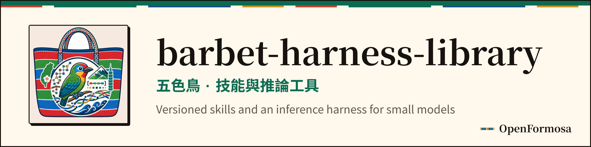

<p align="center"></p>

# Barbet Harness Library

Barbet Harness Library is a set of work guides and a runtime for language models, for developers and researchers who want small models to follow steps and check their own output. It does not change model weights. It changes what the model sees and how its output is checked. On a sealed frozen-weight test, a 1B model's main metric rose from 38.02% to 50.39% (646 questions, 3 seeds; see Results for conditions).

<p align="center">
  <a href="LICENSE"></a>
  
  <a href="https://discord.gg/N4YnrjjcW7"></a>
</p>

<p align="center"><a href="README.md">繁體中文</a> · <b>English</b></p>

<p align="center">
  <a href="skills/">Skills</a> · <a href="docs/">Docs</a> · <a href="https://openformosa.com/projects/">Projects</a> · <a href="https://openformosa.com/community/">Community</a>
</p>

> Formerly the Barbet Skill Library. Old URLs redirect here.

## Why

Small models often know the answer but skip steps or forget to check their output. For example, a model may compute "12 bottles per case, 3 cases" correctly and still add an explanation that breaks the required answer format.

This project provides two things:

- **64 skills**: each says when a type of task applies, the steps, what to do on failure, and how to verify the result.
- **`barbet_inference`**: a runtime that selects skills, reads documents, runs public tests, and repairs failures a bounded number of times.

Guides alone may go unused. A runtime alone does not know how to approach a task. Together they form a harness.

## Quick start

1. Install in this repository, in a separate Python environment (needs a compatible GPU and CUDA):

   ```bash
   python -m venv .venv && source .venv/bin/activate
   pip install -e '.[vllm]'
   ```

2. Ask one question:

   ```bash
   barbet-infer run --family mini \
     --prompt '每箱 12 瓶，買 3 箱共有多少瓶？' --contract number \
     --output outputs/answer.jsonl
   ```

3. Open `outputs/answer.jsonl`. You will see one JSON record. `prediction` holds the model's answer (here it should be `36`), and `validation` holds the format check result.

## Installation

| Item | Requirement |
| --- | --- |
| Python | 3.11 or later (tested on 3.12) |
| OS | Linux (`libseccomp2` is needed for sandboxed code execution) |
| Hardware | A compatible GPU and CUDA for local generation; none when using a remote service |

| Use | Command |
| --- | --- |
| Local generation with vLLM | `pip install -e '.[vllm]'` (pins vLLM 0.23.0, transformers 5.12.1) |
| Remote vLLM-compatible service | `pip install -e '.[tokenizer]'` |
| Read skills only, or bring your own backend | `pip install -e .` |

Without sandboxing support, code execution returns a failure instead of running unsandboxed. Use `--no-execution` to turn off execution and repair.

## Usage

### Wrap a model with `barbet-infer`

Use this when you want checked answers directly.

| Command or flag | Purpose |
| --- | --- |
| `barbet-infer list-skills` | List available skills |
| `barbet-infer prepare ...` | Inspect the prompt, sources, and token budget without generating |
| `--skill NAME` | Use one full skill; without it, short on-demand cards are used |
| `--contract` | Output contract: `text`, `short_answer`, `number`, `python`, `tool_call`, `choice` |

Pinned profiles are included for MiniCPM5-1B (`--family mini`) and Qwen3.5-9B (`--family qwen`). The runtime selects guides by output contract, retrieves user documents, generates, runs public tests in a sandbox for code and checks schemas for tool calls, then retries with the error message a bounded number of times. It never trains the model and never falls back to a larger model.

### Use skills with other models or agents

No Barbet-specific tooling is needed. Pick skills and put the `SKILL.md` text in the model's context. In production, pin a reviewed Git commit and verify content with `markdown_sha256` from the manifest:

```bash
COMMIT="replace-with-reviewed-commit-sha"
BASE="https://raw.githubusercontent.com/OpenFormosa/barbet-harness-library/${COMMIT}"
curl -fLsS "${BASE}/manifest.json" -o manifest.json
curl -fLsS "${BASE}/skills/tool-selection-and-arguments/SKILL.md" -o SKILL.md
```

Start with the applicable `general` skills, then add skills from other domains. Keep each skill's original name and version, and provide it together with the real tool contract.

### Browse skills

Every skill has the same fields. For example, [`arithmetic-modeling`](skills/arithmetic-modeling/SKILL.md):

| Field | Content (excerpt) |
| --- | --- |
| Use when | The user describes quantities in words and needs a result |
| Do not use when | The problem is purely qualitative, or the user already gave a full expression |
| Procedure | Extract values and units → find the relation → check denominators → build the expression → solve → format |
| Failure | Name the missing input; give a symbolic answer instead of refusing when possible |

The 64 skills fall into 7 domains:

| Domain | Count | Examples |
| --- | ---: | --- |
| `general` | 20 | `clarify-missing-inputs`, `arithmetic-modeling`, `tool-selection-and-arguments` |
| `coding` | 13 | `code-task-framing`, `execution-feedback-repair` |
| `math` | 10 | `descriptive-statistics`, `successive-relative-growth` |
| `agent` | 7 | `tool-capability-triage`, `initial-action-planning` |
| `reading` | 6 | `passage-fact-binding`, `unsupported-question-calibration` |
| `writing` | 5 | `constrained-creative-writing`, `translation-alignment` |
| `science` | 3 | `bilingual-science-terms`, `hypothesis-and-evidence` |

People read `SKILL.md` under [`skills/`](skills/). Programs read [`catalog.json`](catalog.json). For pinning, use [`manifest.json`](manifest.json) (paths, versions, scopes, and SHA-256).

## Results

Model weights were frozen. Only the skills and tools the model sees were changed. The 646-question test set was sealed in advance, with 3 seeds and 10 configurations.

| System | Condition | Four-domain main metric ↑ |
| --- | --- | ---: |
| **MiniCPM5-1B + Harness** | Sealed test, 3 seeds | **50.39%** |
| MiniCPM5-1B (bare) | Same test set, no skills or tools | 38.02% |
| Qwen3.5-9B + Harness | Same test set and harness | 76.24% |

**How to read this:** out of 100 questions, the 1B model goes from about 38 correct to about 50 (+12.37 points, paired 95% CI +9.90 to +14.97). A 9B model under the same conditions gets about 76, so the small model still lags clearly.

The main score includes output-format compliance, so part of the gain comes from formatting. This is an internally designed sealed test, not a public benchmark.

## Documentation

- [Inference guide](docs/inference.md) (Chinese): installation, HTTP service, Python API, input format, and outputs
- [Advanced topics](docs/advanced.md) (Chinese): routing extensions, factual answer revisions, test-time components, and short cards
- [Study and results](docs/test-time-study.html) (Chinese) and [reproduction notes](experiments/test_time_v1/README.md)
- [Custom input examples](examples/inference/)

## Limitations

- A post-hoc math diagnosis shows no gain in numeric reasoning. Part of the score gain comes from formatting.
- Matching quotes, valid schemas, or passing public tests do not mean the whole task is correct.
- Some skills were generated automatically by a model with limited testing and review. They are **not human-verified**.
- The skills do not show that Barbet has learned routing, skill composition, or 1M-context use. Real capability must be measured separately.
- Only two model families have built-in profiles. This is not a general adapter for any chat API.
- Skills are procedure prompts. They do not install themselves into other models, and public availability does not give them higher instruction priority in your environment. Review them before adopting.

## Contributing

OpenFormosa is a community project. Everyone can be a contributor. Proposing a new skill is the easiest place to start:

1. Edit `skills/<name>/skill.json` (`SKILL.md` is generated, so do not edit it alone), and bump `version` for semantic changes.
2. Run `python scripts/build.py` and `python scripts/build.py --check` to regenerate `SKILL.md`, `catalog.json`, and `manifest.json`.
3. In the PR, include one applicable example, one similar but non-applicable example, and a way to verify.

- Questions and discussion: [Discord](https://discord.gg/N4YnrjjcW7) or the [community page](https://openformosa.com/community/)
- Bugs and ideas: [Issues](../../issues)
- Pull requests: read [CONTRIBUTING.md](CONTRIBUTING.md) first
- General contact: <hello@openformosa.com>
- Security: <security@openformosa.com> (please do not open a public issue)
- Code of conduct: [CODE_OF_CONDUCT.md](https://github.com/OpenFormosa/openformosa.com/blob/main/CODE_OF_CONDUCT.md); report to <conduct@openformosa.com>

Changes on GitHub do not automatically change published dataset samples.

## License

Code and documentation in this repository are released under the [Apache License 2.0](LICENSE), © 2026 OpenFormosa contributors.

Content quoted from or derived from other sources is not covered by this license and follows its original terms.

## Acknowledgements

Compute and research support come from Taipei-1, NTU Speech Lab, and NTU SPML Lab. Thanks to everyone who opened an issue, sent a pull request, or joined the discussion.

## Citation

```bibtex
@misc{openformosaharness2026,
  title  = {Barbet Harness Library: Versioned Skills and an Inference Harness for Small Language Models},
  author = {{OpenFormosa contributors}},
  year   = {2026},
  url    = {https://github.com/OpenFormosa/barbet-harness-library}
}
```
