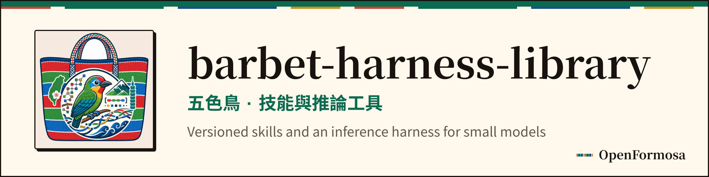

<p align="center"></p>

# Barbet Harness Library

Barbet Harness Library 是給語言模型用的工作手冊與執行框架，適合想讓小模型更守步驟、更會自我檢查的開發者與研究人員。它不改模型權重，只改模型看到什麼、輸出怎麼被檢查；在固定權重的封存測試中，1B 模型的主指標從 38.02% 提升到 50.39%（646 題、3 個 seed，條件見〈效果〉）。

<p align="center">
  <a href="LICENSE"></a>
  
  <a href="https://discord.gg/N4YnrjjcW7"></a>
</p>

<p align="center"><b>繁體中文</b> · <a href="README.en.md">English</a></p>

<p align="center">
  <a href="skills/">技能目錄</a> · <a href="docs/">文件</a> · <a href="https://openformosa.com/projects/">專案頁</a> · <a href="https://openformosa.com/community/">社群</a>
</p>

> 本專案原名 Barbet Skill Library。舊網址會自動轉到這裡。

## 為什麼做這個

小模型常常知道答案，卻跳過步驟，或忘了檢查自己的輸出。例如算「每箱 12 瓶，買 3 箱共有多少瓶」，模型可能算對了，卻多寫一段解釋，導致答案格式不符。

這個專案做兩件事：

- **64 份技能手冊**：每份寫清楚某類任務什麼時候適用、步驟、出錯怎麼辦、怎麼驗收。
- **`barbet_inference` 執行框架**：幫模型挑手冊、讀文件、跑公開測試，失敗時有限次修復。

只有手冊，模型不一定會用。只有框架，模型不知道該怎麼做。兩者合起來，才是一套 harness。

## 快速開始

1. 在本 repo 目錄、獨立的 Python 環境中安裝（需要相容的 GPU 與 CUDA）：

   ```bash
   python -m venv .venv && source .venv/bin/activate
   pip install -e '.[vllm]'
   ```

2. 問一個問題：

   ```bash
   barbet-infer run --family mini \
     --prompt '每箱 12 瓶，買 3 箱共有多少瓶？' --contract number \
     --output outputs/answer.jsonl
   ```

3. 打開 `outputs/answer.jsonl`，會看到一筆 JSON。`prediction` 是模型的答案（這題應該是 `36`），`validation` 記錄格式檢查的結果。

## 安裝

| 項目 | 需求 |
| --- | --- |
| Python | 3.11 以上（測試環境為 3.12） |
| 作業系統 | Linux（隔離執行程式需要 `libseccomp2`） |
| 硬體 | 本機生成需要相容的 GPU 與 CUDA；只連遠端服務時不需要 |

依用途選擇安裝方式：

| 用途 | 指令 |
| --- | --- |
| 本機用 vLLM 生成 | `pip install -e '.[vllm]'`（固定 vLLM 0.23.0、transformers 5.12.1） |
| 連遠端 vLLM 相容服務 | `pip install -e '.[tokenizer]'` |
| 只讀技能，或接自己的後端 | `pip install -e .` |

缺少隔離能力時，程式執行會回傳失敗，不會降級成未隔離執行。可用 `--no-execution` 關閉執行與修復。

## 使用範例

### 用 `barbet-infer` 包住模型

想直接得到經過檢查的答案時用這個。

| 指令或參數 | 用途 |
| --- | --- |
| `barbet-infer list-skills` | 列出可用技能 |
| `barbet-infer prepare ...` | 先看 prompt、來源與 token 預算，不生成 |
| `--skill NAME` | 指定一份完整技能；不指定時使用按需短卡 |
| `--contract` | 輸出契約：`text`、`short_answer`、`number`、`python`、`tool_call`、`choice` |

目前內建 MiniCPM5-1B（`--family mini`）與 Qwen3.5-9B（`--family qwen`）的固定版本設定。框架的流程是：依輸出契約選手冊 → 檢索使用者提供的文件 → 生成 → 程式題在隔離環境跑公開測試、工具呼叫檢查 schema → 失敗時帶著錯誤訊息重試，次數有上限。整個過程不訓練模型，也不會改用大模型代答。

### 在其他模型或 agent 裡使用技能

不需要 Barbet 專用工具。挑好技能，把 `SKILL.md` 的文字放進模型前文即可。正式使用時，請固定到一個審查過的 Git commit，並用 manifest 裡的 `markdown_sha256` 核對內容：

```bash
COMMIT="replace-with-reviewed-commit-sha"
BASE="https://raw.githubusercontent.com/OpenFormosa/barbet-harness-library/${COMMIT}"
curl -fLsS "${BASE}/manifest.json" -o manifest.json
curl -fLsS "${BASE}/skills/tool-selection-and-arguments/SKILL.md" -o SKILL.md
```

先放入適用的 `general` 技能，再依任務加入其他領域的技能。請保留技能的原始名稱與版本，並和實際工具契約一起提供。

### 瀏覽技能

每份技能都有同樣的欄位。以 [`arithmetic-modeling`](skills/arithmetic-modeling/SKILL.md) 為例：

| 欄位 | 內容（節錄） |
| --- | --- |
| 何時使用 | 使用者用文字描述數量關係，需要算出結果 |
| 何時不要用 | 問題只有定性描述，或使用者已給完整算式 |
| 步驟 | 抽出數值與單位 → 找出運算關係 → 檢查分母 → 組出算式 → 求解 → 依格式輸出 |
| 失敗處理 | 缺資訊時標出缺什麼；能給符號解就不拒答 |

64 份技能分成 7 個領域：

| 領域 | 數量 | 例子 |
| --- | ---: | --- |
| `general` 一般指令 | 20 | `clarify-missing-inputs`、`arithmetic-modeling`、`tool-selection-and-arguments` |
| `coding` 程式 | 13 | `code-task-framing`、`execution-feedback-repair` |
| `math` 數學 | 10 | `descriptive-statistics`、`successive-relative-growth` |
| `agent` 工具與代理 | 7 | `tool-capability-triage`、`initial-action-planning` |
| `reading` 閱讀 | 6 | `passage-fact-binding`、`unsupported-question-calibration` |
| `writing` 寫作 | 5 | `constrained-creative-writing`、`translation-alignment` |
| `science` 科學 | 3 | `bilingual-science-terms`、`hypothesis-and-evidence` |

三種讀法：人讀 [`skills/`](skills/) 底下的 `SKILL.md`；程式讀 [`catalog.json`](catalog.json)；固定版本看 [`manifest.json`](manifest.json)（路徑、版本、範圍與 SHA-256）。

## 效果

固定模型權重，只改變模型看到的技能與工具。測試集共 646 題，事先封存，跑 3 個 seed、比較 10 組設定。

| 系統 | 條件 | 四領域主指標 ↑ |
| --- | --- | ---: |
| **MiniCPM5-1B + Harness** | 封存測試，3 seeds | **50.39%** |
| MiniCPM5-1B（bare） | 同一測試集，不加技能與工具 | 38.02% |
| Qwen3.5-9B + Harness | 同一測試集與 harness | 76.24% |

**怎麼讀這些數字：** 每 100 題，1B 模型答對的題數從約 38 題增加到約 50 題（+12.37 個百分點，配對 95% CI +9.90 至 +14.97）。但同樣條件下的 9B 模型約答對 76 題，小模型仍有明顯差距。

主評分包含輸出格式是否正確，所以有一部分提升來自格式。這是內部設計的封存測試，不是公開基準。

## 文件

- [推論工具使用說明](docs/inference.md)：安裝、HTTP 服務、Python API、輸入格式與輸出意義
- [進階內容](docs/advanced.md)：輸入路由擴充、事實回答修訂、test-time 元件與短卡
- [中文分析與實驗結果](docs/test-time-study.html)與[重現說明](experiments/test_time_v1/README.md)
- [事實回答校準](docs/factual-calibration.md)
- [1B 技能與公開解法指引](docs/student-1b-guidance.md)
- [自訂輸入範例](examples/inference/)

## 限制

- 數學題的事後診斷，沒有看到數值推理變好。分數提升有一部分來自格式。
- 來源引句吻合、schema 合法或公開測試通過，都不等於整題答對。
- 部分技能由模型自動生成，只經過有限的測試與審查，**不是人工逐一驗證**的版本。
- 技能沒有證明 Barbet 已學會路由、組合技能或使用 1M 前後文。實際能力需要另外量測。
- 目前只內建兩個模型家族的設定，不是任意 chat API 的通用轉接器。
- 技能是程序提示，不會自動安裝到其他模型。公開讀得到，也不代表它在你的環境裡有更高的指令優先權，請自行審查後再採用。

## 參與貢獻

OpenFormosa 是社群專案，每個人都可以是貢獻者。提議一份新技能，是最容易上手的入口：

1. 編輯 `skills/<name>/skill.json`（`SKILL.md` 是自動生成的，不要只改它），有語義變更時更新 `version`。
2. 執行 `python scripts/build.py` 與 `python scripts/build.py --check`，重新產生 `SKILL.md`、`catalog.json` 與 `manifest.json`。
3. 在 PR 附上一個適用例、一個相似但不適用的例子，以及驗證方法。

- 討論與提問：[Discord](https://discord.gg/N4YnrjjcW7) 或 [社群頁](https://openformosa.com/community/)
- 回報問題或提議功能：[Issues](../../issues)
- 送出修改：請先讀 [CONTRIBUTING.md](CONTRIBUTING.md)
- 一般聯絡：<hello@openformosa.com>
- 安全問題：<security@openformosa.com>（請不要公開發 issue）
- 行為準則：[CODE_OF_CONDUCT.md](https://github.com/OpenFormosa/openformosa.com/blob/main/CODE_OF_CONDUCT.md)，回報請寄 <conduct@openformosa.com>

GitHub 上的變更不會自動改動已發布的資料集樣本。

## 授權

本 repository 的程式碼與文件以 [Apache License 2.0](LICENSE) 釋出，© 2026 OpenFormosa contributors。

引用或衍生自其他來源的內容不在此授權範圍內，依其原始條款使用。

## 致謝

本專案的運算資源與研究支持來自 Taipei-1、臺大語音實驗室（NTU Speech Lab）與 NTU SPML Lab。感謝每一位提出問題、送出 PR 與參與討論的貢獻者。

## 引用

```bibtex
@misc{openformosaharness2026,
  title  = {Barbet Harness Library: Versioned Skills and an Inference Harness for Small Language Models},
  author = {{OpenFormosa contributors}},
  year   = {2026},
  url    = {https://github.com/OpenFormosa/barbet-harness-library}
}
```
